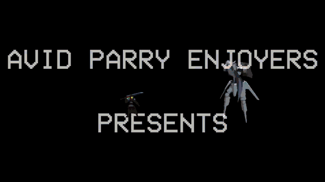

# HA:RD — Heavy Assault: Rust & Dust

A 2D action boss-fight game built around **parrying**. Time your defence right and the fight swings your way: a well-timed parry refills your ammo, builds your rage and briefly slows time.

---

## About

| | |
|---|---|
| **Genre** | 2D action, boss fights |
| **Built with** | C++, Alpha Engine (DigiPen) |
| **Team** | 5 students, Avid Parry Enjoyers |
| **Course** | CSD1451, Singapore Institute of Technology × DigiPen |
| **Timeline** | Jan to Apr 2025 |

## Play it

**[Download the Windows build](https://drive.google.com/drive/folders/1B86CjflMuWHATOenwI20V10P8-394v5M?usp=sharing)** — unzip the whole folder and run `Game.exe` (keep it next to the `Assets` folder).
If it doesn't start, install Microsoft's [Visual C++ Redistributable](https://learn.microsoft.com/cpp/windows/latest-supported-vc-redist).

## My role: Tan Jun Quan

**Team lead, gameplay programmer, and pixel artist**

- **Built the core player logic**, including movement, the dash, the melee combo, and the parry and block system.
- **Designed the parry and block timing.** Holding `E` defends, facing the mouse:
  - The **first 0.3 seconds is a parry**. Parrying an attack **refills your ammo, resets the defence cooldown and builds your rage meter**. Parrying a boss also **slows time to 30% for a moment** for dramatic effect :)
  - **Up to 1 second, it becomes a block.** Blocking **halves the damage** you take, but **resets your combo and rage**.
  - **Then a 2-second cooldown.**

  Holding block is safe but costly, and timing a parry is rewarded, so players are pushed to read the boss and react.
- **Wrote the `SpriteSheet` class**, which loads a sprite sheet, splits it into frames and handles looping animation. It's how the game's animations get on screen.
- **Helped finalise Boss 1 and Boss 2 logic.**
- **Built the tutorial**, as an overlay in the hub world, and **the camera**, which follows the player and leans toward the mouse.

## My art

- **Player:** idle, walk, hurt, dash, parry and block (with indicators: a green outline shows when a parry will land), the three-hit combo, shooting, the heavy laser shot, and death.
- **Bosses:** both bosses' full animation sets, Boss 1's fist, and Boss 2's lightning ball and lightning wave.
- **UI:**
  - A crosshair with an ammo indicator.
  - "Racecar" HUD indicators by the crosshair for parry and dash cooldown and availability.
  - A spark that flags an enemy attack that's good to parry (parrying it stuns them).
  - A health bar styled to look like the sword, which also holds ammo and rage meter information.
  - The logo, with a looping "shine swipe" animation.
  - Tutorial key prompts.
- **Hub world:** two training dummies, a looping campfire, and a looping spirit (the campfire, without the base).

**Where to look in the code**

| Area | Files |
|---|---|
| Player, combat, parry and block | [`player.cpp`](PARRY%20PING%20PING/Source/player.cpp) · [`player.h`](PARRY%20PING%20PING/Source/Headers/player.h) |
| Animation | [`SpriteSheet.cpp`](PARRY%20PING%20PING/Source/SpriteSheet.cpp) · [`SpriteSheet.h`](PARRY%20PING%20PING/Source/Headers/SpriteSheet.h) |
| Tutorial | [`Tutorial.cpp`](PARRY%20PING%20PING/Source/Tutorial.cpp) |
| Camera | [`Camera.cpp`](PARRY%20PING%20PING/Source/Camera.cpp) |

## How to play

- **Fight up close to load your gun.** Each melee hit restores 1 ammo, up to 3.
- **Tap right click** for a light shot, or **hold it with full ammo** for the heavy laser, which uses all 3.
- **Weave light shots between melee hits** to attack much faster.
- **Parry to turn the fight around.** A parry negates the damage and refills your ammo. An attack marked with an **orange spark** stuns the boss when parried.

## Controls

| Action | Input |
|---|---|
| Move | `W` `A` `S` `D` |
| Dash | `Space` (while moving) |
| Aim / move camera | Mouse |
| Melee attack (combo) | Left click, aimed with the mouse |
| Ranged attack | Right click (uses ammo) |
| Heavy laser | Hold right click with full ammo |
| Parry / block | Hold `E` |
| Interact (hub world) | `F` |
| Tutorial (hub world) | `T` |
| Pause | `Esc` |
| Skip splash screen | `Esc`, left or right click, `Space` or `Enter` |
| Fast-forward credits | Hold right `Shift` |

**Debug keys** (left in for testing): `B` restarts the level or hub world, `N` defeats the boss.
The modifier computer in the hub world also has an invulnerable difficulty setting.

## Building from source

**Requirements:** Windows, Visual Studio 2022

1. Clone the repo.
2. Open `PARRY PING PING/AlphaFirst.sln` in Visual Studio.
3. Build and run (`F5`).

The Alpha Engine is DigiPen's teaching engine and is included for portfolio purposes.

## Team: Avid Parry Enjoyers

| Name | Main contributions |
|---|---|
| Tan Jun Quan | Team lead; core player logic, parry and block, `SpriteSheet` class, tutorial, camera; helped finalise both bosses; pixel art and animation |
| Manfred Sim | Game state manager, menus, initial boss logic, a large share of the serialization, and Boss 1's explosive death effect |
| Muhammad Fauzan | Leaderboard system and background maps, and helped across other areas |
| Muhammad Raziq | The bosses, and helped across other areas |
| Muhammad Ashfer | Design and game feel: the hub world, training dummies, and ideas such as crosshair information and slow motion on a successful parry |

## Credits

**Instructors:** Ding Xiang Cheng, Gerald Wong, Soroor Malekmohmmadi Faradounbeh

**Music and sound**
- Hub world: Dark Ambient Music (royalty free), [YouTube](https://www.youtube.com/watch?v=x74grrke9qE)
- Boss 2: *Space Debris* by David Robson
- Background music: [Fesliyan Studios](https://www.fesliyanstudios.com/royalty-free-music)
- Sound effects: [Pixabay](https://pixabay.com/sound-effects)

## License

Student project created at DigiPen Institute of Technology Singapore / Singapore Institute of Technology.
All content © 2025 DigiPen Institute of Technology Singapore. All rights reserved. Shared for portfolio purposes only.
